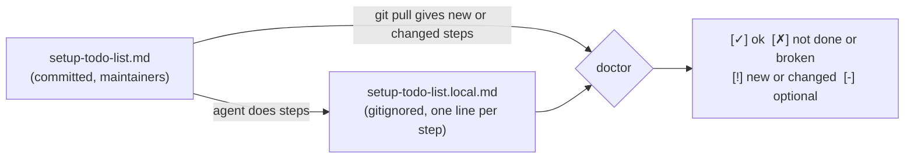

# AI-runnable project setup

[](https://github.com/epatel/project-setup/actions/workflows/audit.yml)

This repository gives a format and a Claude Code skill for project setup instructions. An AI agent can do the setup steps, continue a setup that stopped, and examine the setup again later. The last function is similar to `flutter doctor`.



## Add the setup format to a project

Give this instruction to a coding agent (Claude Code, Codex, Cursor, or a different agent):

> See https://raw.githubusercontent.com/epatel/project-setup/main/ADOPT.md and add project setup instructions to this repo.

The agent does these tasks:

1. It copies the skill into `.claude/skills/project-setup/`.
2. It reads the repository to find all the setup steps. This includes steps that the README does not show.
3. It writes `setup-todo-list.md`.
4. It adds the local progress file to `.gitignore`.
5. It updates the README.

The agent does not make a commit. You must examine the result.

## Install the skill for all your projects (Claude Code plugin)

Do these commands in a shell:

```bash
claude plugin marketplace add epatel/project-setup
claude plugin install project-setup@epatel --scope user
```

The option `--scope user` makes the skill available in all your projects. If you do not use this option, the skill is available only in the current project.

- **To examine the installation:** Do `claude plugin list`. Make sure that the list shows `project-setup@epatel` with `Scope: user`.
- **To update the plugin:** Do `claude plugin update project-setup@epatel`.
- **To install in a Claude Code session:** Do `/plugin install project-setup --marketplace epatel/project-setup`. The first time, this command can add only the marketplace. Do the command again until it shows "Installed". This command installs the skill only for the current project.

## How the format works

- **`setup-todo-list.md`** is in the repository. It contains the setup steps. Each step has these parts:
  - an `[id]` that does not change
  - a `rev` number
  - a `gate`: `auto`, `approve` or `input`
  - a `required` flag
  - a `check` command that does not change files
- **`setup-todo-list.local.md`** is not in the repository. It contains one progress line for each step, for example `- flutter-sdk: done @rev2 2026-11-21`. The agent writes a line after each step. Thus, the agent can continue a setup that stopped.
- **Doctor** compares the progress lines with the list. It uses the `id` and the `rev` of each step. Thus, it finds new steps, changed steps and removed steps. Then it does the `check` commands again. Thus, it finds steps that were done but are now broken. For example, a tool was removed from the computer.
- **The progress file keeps the commit hash of the list.** The command `git diff <hash> -- setup-todo-list.md` shows the changes in the list since the last setup.
- **Secrets** go only into `.env` or a similar file. Do not put secrets into the list or into the progress file.
- **The list starts with instructions for agents.** Thus, all coding agents can use the list. The skill makes the work more reliable.

The full specification is in [`skills/project-setup/references/format.md`](skills/project-setup/references/format.md). For examples, see [`examples/setup-todo-list.md`](examples/setup-todo-list.md) and its progress file [`examples/setup-todo-list.local.md`](examples/setup-todo-list.local.md).

## Use the skill in Claude Code

| Command or request | Result |
|---|---|
| `/project-setup` or "set up this project" | The agent makes the progress file, shows the plan, and does the steps. It obeys the gate of each step. |
| `/project-setup doctor` or "check my setup" | The agent shows a report. The report shows new steps, changed steps and broken steps. |
| `/project-setup author` or "make a setup list for this repo" | The agent writes `setup-todo-list.md`. It uses the README, the CI configuration, `.env.example` and other files. |

With the plugin, the full name of the skill is `/project-setup:project-setup`. The short name `/project-setup` also operates. But if a repository has its own copy of the skill, the short name starts that copy.

## When to use doctor

Use doctor only when necessary. Setup steps do not change frequently. The skill tells the agent not to start doctor without a request.

- **Usually:** Use doctor only when you want a report.
- **Fast stop:** The progress file keeps `master-commit`. This is the last commit hash of the list. If the hash is the same and the list has no changes that are not committed, the agent stops.
- **After a pull:** You can add this hook. It shows a message only when the list changed.

  ```bash
  # .githooks/post-merge
  git diff --quiet ORIG_HEAD HEAD -- setup-todo-list.md ||
    echo "setup-todo-list.md changed — consider: setup doctor"
  ```

**WARNING:** The `check` commands come from the repository. They run in your shell. If you do not trust a repository, read its `check` commands before an agent runs doctor.

## Rules for maintainers

The rules are in [the maintainer rules in format.md](skills/project-setup/references/format.md#maintainer-rules). In summary:

- Do not use an `id` again.
- Increase `rev` only when the meaning of a step changes.
- Make sure that each `check` command is fast and does not change files.
- Use `auto` only for safe steps in the project.

## Repository layout

```
.claude-plugin/        plugin.json and marketplace.json (this repository is both)
skills/project-setup/  the skill (SKILL.md, references/format.md)
ADOPT.md               instructions for an agent that adds the format to a project
examples/              example setup list and progress file
.github/               audit workflow and audit script (only for CI)
```

## Audit

The audit workflow runs for each push, for each pull request, and one time each week. It does these checks:

- The example lists obey format v1.
- Each `check` command has correct shell syntax (`bash -n`).
- The agent instructions in each example list are the same as the instructions in format.md.
- The plugin, the marketplace and the skill are correct (`claude plugin validate --strict`).
- The relative links are correct.
- The download URLs in ADOPT.md are available.

## Releases

ADOPT.md downloads the skill from a release tag. The current tag is **`v1.1.1`**. Thus, projects do not get changes that are not released. Tags do not move.

To make a release:

1. Change `version` in `.claude-plugin/plugin.json`.
2. Change the tag in the two URLs in ADOPT.md.
3. Commit the changes.
4. Add the tag `vX.Y.Z`.
5. Push the branch and the tag together: `git push origin main vX.Y.Z`.
