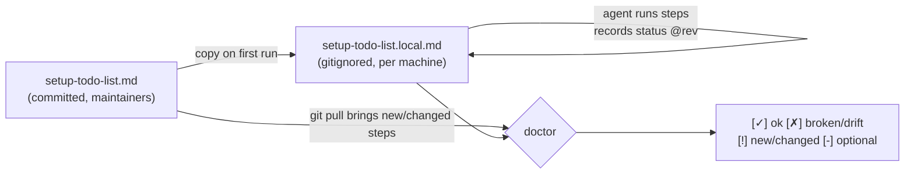

# AI-runnable project setup

[](https://github.com/epatel/project-setup/actions/workflows/audit.yml)

A convention, plus a Claude Code skill, for project setup instructions that an AI agent can run, resume, and re-check, much like `flutter doctor`.



## Add it to a project

Point any coding agent (Claude Code, Codex, Cursor, …) at the adoption instructions:

> See https://raw.githubusercontent.com/epatel/project-setup/main/ADOPT.md and add project setup instructions to this repo.

The agent copies the skill into `.claude/skills/project-setup/`, reads the repo to work out what setup really involves (including things the README leaves out), writes `setup-todo-list.md`, gitignores the local progress file and updates the README. It doesn't commit anything; you review the result.

## Install the skill for yourself (Claude Code plugin)

So that `/project-setup` is available in every repo, including ones that haven't adopted it yet:

```
/plugin install project-setup --marketplace epatel/project-setup
```

Or from a shell: `claude plugin marketplace add epatel/project-setup && claude plugin install project-setup@epatel`. Update later with `claude plugin update project-setup@epatel`.

## The idea

- **`setup-todo-list.md`** is committed. Each step has a stable `[id]`, a `rev`, a `gate` (`auto` / `approve` / `input`), a `required` flag, and a read-only `check` command.
- **`setup-todo-list.local.md`** is gitignored progress, one line per step (`- flutter-sdk: done @rev2 2026-11-21`), written by the agent as it goes, so an interrupted setup can pick up where it stopped.
- **Doctor**: compares the progress lines with the list by id and rev, which surfaces new, changed and removed steps. It then re-runs the checks to catch drift (e.g. a tool that was later uninstalled). The progress file records the list's commit hash, so `git diff <hash> -- setup-todo-list.md` shows exactly what changed.
- **Secrets** go only into `.env` or similar, never into either list.
- The master file opens with a short blockquote of agent instructions, so it works with **any** coding agent. The skill just makes it more reliable.

The full spec is in [`skills/project-setup/references/format.md`](skills/project-setup/references/format.md). Examples: [`examples/setup-todo-list.md`](examples/setup-todo-list.md) and its progress file [`examples/setup-todo-list.local.md`](examples/setup-todo-list.local.md).

## Usage (Claude Code)

| Say | Does |
|---|---|
| `/project-setup` or "set up this project" | Creates the progress file, shows the plan, runs the steps with their gates |
| `/project-setup doctor` or "check my setup" | Report only: new or changed steps plus drift |
| `/project-setup author` or "make a setup list for this repo" | Drafts `setup-todo-list.md` from the README, CI, `.env.example`, etc. |

With the plugin, the full name is `/project-setup:project-setup`. The short `/project-setup` works unless a repo's own copy of the skill uses the same name, in which case the repo's copy wins.

## How often to run doctor

Rarely. Setup steps seldom change, and the agent is told never to run doctor on its own.

- **Normally:** only when you ask for it.
- **Cheap skip:** the progress file records `master-commit`, the master's last commit hash at the last sync. If `git log -1 --format=%h -- setup-todo-list.md` still matches and there are no uncommitted edits, the agent stops there.
- **After a pull**, an optional hook that costs nothing unless the list file changed:

  ```bash
  # .githooks/post-merge
  git diff --quiet ORIG_HEAD HEAD -- setup-todo-list.md ||
    echo "setup-todo-list.md changed — consider: setup doctor"
  ```

`check` commands come from the repo and run through your shell. On a repo you don't trust, read them before letting an agent run doctor.

## Maintainer rules

See [Maintainer rules in format.md](skills/project-setup/references/format.md#maintainer-rules): never reuse an id, bump `rev` only when a step's meaning changes, keep checks read-only and fast, and use `auto` only for safe local steps.

## Repository layout and releases

```
.claude-plugin/        plugin.json + marketplace.json (this repo is both)
skills/project-setup/  the skill (SKILL.md, references/format.md)
ADOPT.md               instructions an agent follows to adopt this in a repo
examples/              sample setup-todo-list.md
.github/               audit workflow + script (CI only)
```

The audit workflow runs on every push, on pull requests, and weekly. It checks the example lists against format v1 (including `bash -n` on every `check`, and that the agent block matches the canonical one in format.md), the plugin, marketplace and skill (`claude plugin validate --strict`), relative links, and that ADOPT.md's download URLs resolve.

ADOPT.md downloads the skill from the **`v1`** tag, so adopting projects don't pick up unreleased changes. To release: bump `version` in `.claude-plugin/plugin.json`, tag `vX.Y.Z`, and move `v1` (`git tag -f v1 && git push -f origin v1`). Use a new major tag only if the setup-todo-list format changes incompatibly.
