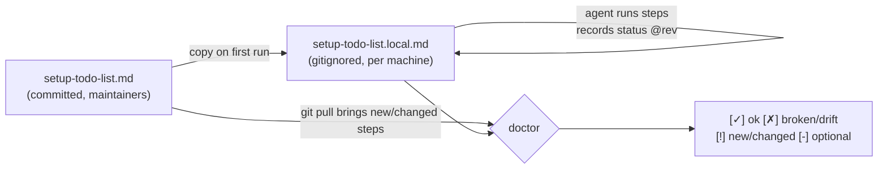

# AI-runnable project setup

A convention, plus a Claude Code skill, for project setup instructions that an AI agent can run, resume, and re-check, much like `flutter doctor`.



## The idea

- **`setup-todo-list.md`** is committed. Each step has a stable `[id]`, a `rev`, a `gate` (`auto` / `approve` / `input`), a `required` flag, and a read-only `check` command.
- **`setup-todo-list.local.md`** is a gitignored copy. The agent writes `status: done @rev2 2026-11-21` (or `skipped`, `failed`) under each step as it goes, so an interrupted setup can pick up where it stopped.
- **Doctor**: after a pull, the agent compares the two files by id and rev. That surfaces new steps, steps whose rev went up, and removed steps. It then re-runs every `check` to catch drift (e.g. a tool that was later uninstalled).
- **Secrets** go only into `.env` or similar, never into either list.
- The master file opens with a short blockquote of agent instructions, so it works with **any** coding agent. The skill just makes it more reliable.

The full spec is in [`.claude/skills/project-setup/references/format.md`](.claude/skills/project-setup/references/format.md). For a realistic master file, see [`examples/setup-todo-list.md`](examples/setup-todo-list.md).

## Install the skill

Pick one:

- **Per project (recommended):** copy `.claude/skills/project-setup/` into the target repo and commit it. Anyone who clones the repo gets it.
- **Personal:** copy it to `~/.claude/skills/project-setup/`.

## Usage (Claude Code)

| Say | Does |
|---|---|
| `/project-setup` or "set up this project" | Creates the local copy, shows the plan, runs the steps with their gates |
| `/project-setup doctor` or "check my setup" | Report only: new or changed steps plus drift |
| `/project-setup author` or "make a setup list for this repo" | Drafts `setup-todo-list.md` from the README, CI, `.env.example`, etc. |

## Deterministic doctor script

The skill runs `.claude/skills/project-setup/scripts/setup_doctor.py` instead of comparing the files by eye. It needs Python 3 and nothing else, and it works without any AI:

```bash
python3 .claude/skills/project-setup/scripts/setup_doctor.py              # report, runs checks
python3 .claude/skills/project-setup/scripts/setup_doctor.py --reconcile  # also sync the local copy
python3 .claude/skills/project-setup/scripts/setup_doctor.py --json       # machine-readable
python3 .claude/skills/project-setup/scripts/setup_doctor.py --no-checks  # don't execute check commands
```

Exit codes: `0` all good, `1` something is broken or not done, `2` only new or changed steps, `3` parse error in the list. That makes it usable in a `post-merge` git hook or CI, for example to fail if `setup-todo-list.md` doesn't parse:

```bash
# .githooks/post-merge — nudge after every pull
python3 .claude/skills/project-setup/scripts/setup_doctor.py --no-checks >/dev/null
[ $? -eq 2 ] && echo "setup-todo-list.md changed — run: setup doctor"
```

`check` commands come from the repo and run through your shell. Use `--no-checks` on repositories you don't trust.

## Adopting in a repo

1. Run `/project-setup author`, then review the draft. Pay most attention to the gates and the `check` commands.
2. Commit `setup-todo-list.md` and add `setup-todo-list.local.md` to `.gitignore`.
3. Add to the README:
   ```markdown
   ## Setup
   With Claude Code (or any coding agent): *"Set up this project using setup-todo-list.md"*.
   After pulling, re-check with *"run setup doctor"*.
   Every step in setup-todo-list.md also reads as plain manual instructions.
   ```
4. Add to CLAUDE.md / AGENTS.md:
   ```markdown
   Project setup lives in setup-todo-list.md (progress in the gitignored setup-todo-list.local.md).
   If a command fails because of missing tooling, run setup doctor before debugging.
   ```

## Maintainer rules

- Never reuse or rename an `id`. Retire it and add a new one instead.
- Bump `rev` when a step's meaning changes (new minimum version, different command). Don't bump it for wording fixes.
- Every `check` must be read-only, fast, and exit 0 when the step is satisfied.
- `auto` is only for read-only or project-local, reversible steps. Anything global, `sudo`, or networked-with-side-effects is `approve`.
